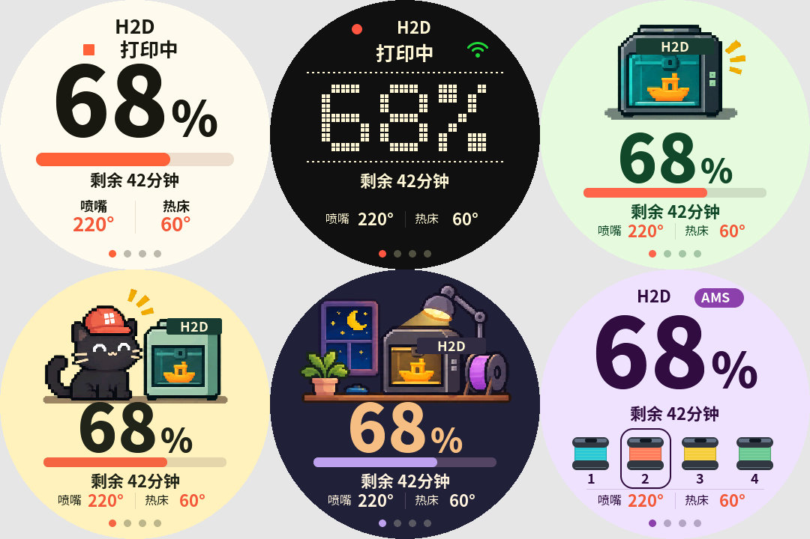
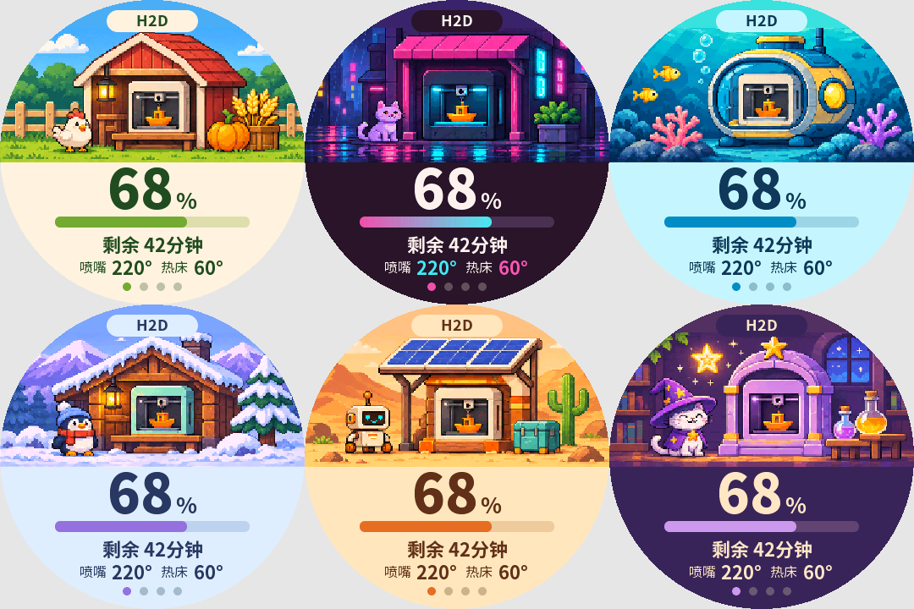
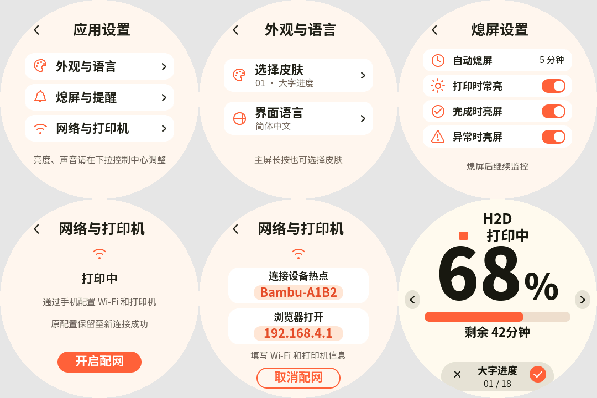
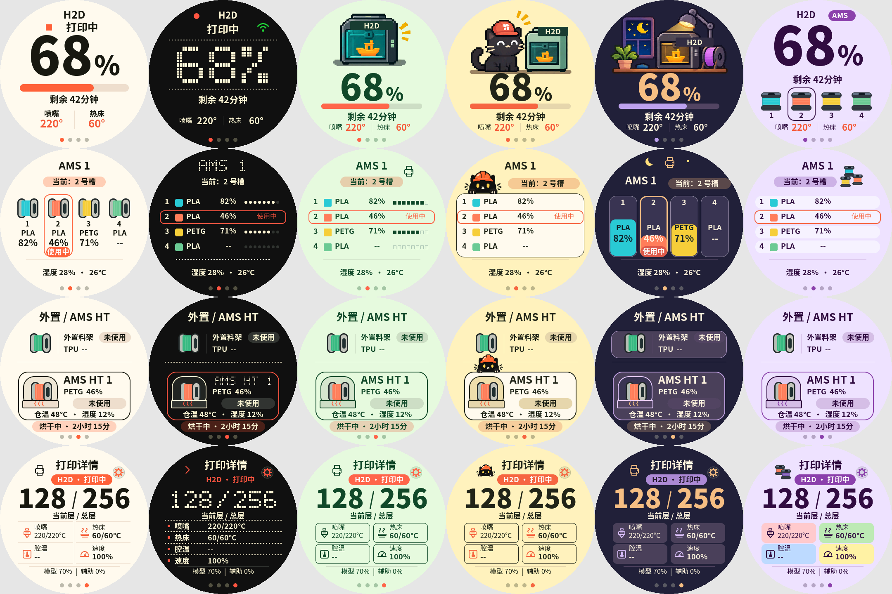
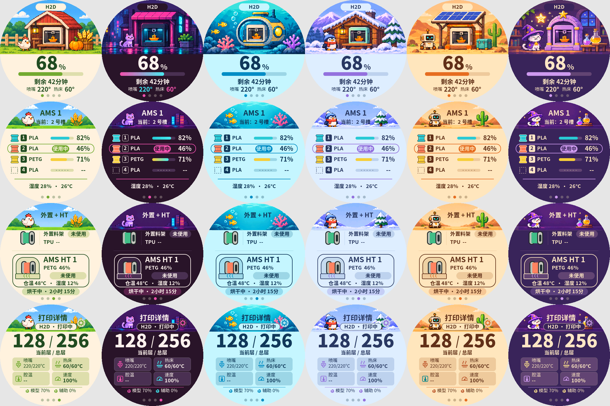

# SDGoods 拓竹监视器

在 SDGoods 圆屏设备上查看拓竹打印机的实时状态。通过局域网连接打印机，显示打印进度、剩余时间、温度和耗材信息，提供 18 款可切换皮肤，兼容 SDGoods 官方启动器与下拉控制中心。

当前版本：**0.3.9** · 硬件：**SDGoods ESP32-S3 圆屏设备** · 构建环境：**ESP-IDF 5.5.x**。

## 18 款风格总览

以下为实际界面绘制代码的软件渲染，使用示例数据。每组按从左到右、从上到下排列；实际型号和读数由已连接的打印机提供。

### 01–06

大字进度 · 点阵终端 · 像素工坊 · 猫咪监工 · 夜班打印室 · 彩色料仓



### 07–12

纸感标签 · 掌机像素 · 机器人助手 · 竹林工坊 · 太空货舱 · 拼色几何


### 13–18

农场造物 · 赛博街区 · 海底实验室 · 雪山木屋 · 沙漠基地 · 魔法工坊



### 设置与选肤

第一行：应用设置、外观与语言、熄屏设置。第二行：网络与打印机、手机配网、全屏皮肤预览。



### 各风格完整页面

展开可查看首页、AMS、外置料架 / AMS HT、打印详情。每张图按列对应6款风格，按行对应四类页面；第二、三组外置 / HT 页为主题延展候选。

<details>
<summary>01–06：四类页面完整预览</summary>



</details>

<details>
<summary>07–12：四类页面完整预览</summary>


</details>

<details>
<summary>13–18：四类页面完整预览</summary>



</details>

## 功能

- **打印概览**：打印机型号、打印状态、进度、剩余时间、喷嘴与热床温度。
- **AMS 耗材**：料槽、材质、颜色、剩余量、当前使用槽，以及设备上报的温湿度。
- **外置料架与 AMS HT**：集中显示外挂耗材、HT 状态、温湿度及烘干剩余时间。
- **打印详情**：当前层 / 总层、当前与目标温度、腔温、速度和风扇读数。
- **18 款皮肤**：支持首页长按进入全屏实时预览，左右切换并保存。
- **设备设置**：手机配网、中英文切换、自动熄屏、打印时常亮、完成或异常时亮屏。

页面按“首页 → 普通 AMS → 外置料架 / AMS HT → 打印详情”组织，并根据实际连接的耗材盒数量展开。

型号、余量、腔温和烘干等字段取决于打印机及耗材盒的实际回报。未知读数显示 `--`；未取得可识别型号时显示 `BAMBU`。

## 首次连接

先准备 Wi-Fi 名称和密码，以及打印机的 **IP 地址、序列号和 8 位访问码**。设备与打印机需要处于可互相访问的局域网，打印机需允许局域网 MQTT 连接。

1. 安装应用或烧录固件后启动。首次未配置时，设备会开启 `Bambu-XXXX` 热点。
2. 用手机连接该热点，浏览器打开 **http://192.168.4.1**。
3. 填写 Wi-Fi 和打印机信息，提交验证。
4. 验证成功后进入监控页面。验证失败会在网页显示原因，并保留原有配置。

需要更换网络或打印机时，打开 **打印详情 → 设置 → 网络与打印机 → 开启配网**。

## 操作

- **翻页**：在监控页面中部左右滑动。
- **打开设置**：点击打印详情页右上方的圆形齿轮按钮。
- **返回上一级**：在设置页面中部右滑、点击左上角箭头，或短按电源键。
- **亮度、声音与退出**：从顶部下滑，使用官方控制中心。
- **熄屏后唤醒**：首次触摸仅唤醒屏幕，后台继续监控。

配网进行中返回会先取消配网，待网络切换完成后回到设置。

### 切换皮肤

在打印首页中部静止长按约 **0.7 秒**，或打开 **设置 → 外观与语言 → 选择皮肤**。

1. 左右滑动，实时预览当前数据在各款皮肤中的效果。
2. 点右下角勾选保存；点左下角叉号或短按电源键取消。
3. 预览操作条空闲 3 秒后隐藏，轻点屏幕可重新显示。

18 款皮肤包括：

- 大字进度、点阵终端、像素工坊、猫咪监工、夜班打印室、彩色料仓。
- 纸感标签、掌机像素、机器人助手、竹林工坊、太空货舱、拼色几何。
- 农场造物、赛博街区、海底实验室、雪山木屋、沙漠基地、魔法工坊。

### 熄屏与提醒

在 **设置 → 熄屏与提醒** 中设置自动熄屏时间：永不、1 分钟、5 分钟或 15 分钟。打印时常亮、完成时亮屏和异常时亮屏可分别开关。

## 编译与烧录

安装并激活 **ESP-IDF 5.5.x** 环境。本项目使用 5.5.5 验证，目标芯片为 **ESP32-S3**。以下以 Windows 和串口 **COM6** 为例，其他串口请替换端口号。

### 标准构建与烧录

在 ESP-IDF 终端执行：

```powershell
cd D:\2.Project\SDGOODS\sdgoods-bambu-monitor
idf.py build
idf.py merge-bin
copy build\merged-binary.bin build\sdgoods-bambu-monitor-full.bin
idf.py -p COM6 flash
```

只有一个工程和一个标准 `build` 目录，一次构建包含全部 18 款皮肤，在设备内切换。

### 烧录已有完整固件

已有 `build\sdgoods-bambu-monitor-full.bin` 时，也可直接执行：

```powershell
python -m esptool --chip esp32s3 -p COM6 --baud 460800 write_flash 0x0 build\sdgoods-bambu-monitor-full.bin
```

完整镜像从 `0x0` 写入，会覆盖其范围内的应用、NVS 设置及启动选择，烧录后可能需要重新配网。标准 `flash` 与完整镜像烧录按实际用途选择一种。

### 查看串口日志

```powershell
idf.py -p COM6 monitor
```

按 `Ctrl+]` 退出。更新后再次烧录当前构建可执行 `idf.py -p COM6 flash`。

## 官方应用包

完成构建后执行：

```powershell
python tools/firmware/pack_app.py --name BambuMonitor_app.bin
```

输出 `dist/BambuMonitor_app.bin` 及校验元数据，用于 SDGoods 官方平台安装和切换应用。打包工具会校验镜像类型与容量。

此文件是纯应用包；从 `0x0` 烧录时应使用上文的完整固件镜像。

## 真机截图

连接设备并停留在目标页面，双击项目根目录的 **串口截图.cmd**，默认使用 COM6。截图按时间命名保存到 `docs/verification/device/screenshots/`，接收完成后自动打开。

截图前退出串口监视器及其他占用 COM6 的程序。设备发送 JPEG 时保存为 `.jpg`，原始像素回退时保存为 `.png`。

## 常见问题

- **连接不上打印机**：核对 Wi-Fi、打印机 IP、序列号与访问码，并检查双方是否可通过局域网访问。配网页会返回验证失败的原因。
- **型号仍显示 BAMBU**：尚未取得可识别的型号回报；可查看串口日志中的型号查询与识别结果。
- **部分数值显示 --**：该字段尚未收到或设备没有提供，不代表数值为零。
- **截图或烧录提示串口被占用**：退出 `idf.py monitor`，或关闭其他串口程序后重试。

## 开发与素材

```text
main/        应用、数据服务、皮肤、运行素材与字体
components/  官方组件和第三方依赖
platform/    平台分区与预置资源
tools/      构建、素材生成、截图和校验工具
docs/       设计、素材、架构、验证和历史资料
```

- [文档总入口](docs/README.md)：当前设计、架构及验证资料。
- [工具分类](tools/README.md)：打包、截图、素材生成及检查命令。
- [架构说明](docs/architecture/README.md)：官方层与应用层边界、线程和数据流。
- [素材导航](docs/assets/CATALOG.md)：原型、原图、字体、编码与转换脚本的对应关系。
- [Git 提交范围](docs/architecture/git.md)：源码和核心素材的提交规则。

原图、原型、字体源及真机反馈随项目保存。批量软件渲染帧、编译产物和私有完整备份保留本地，具体保存范围见素材与 Git 说明。

## 项目状态

18 款皮肤及监控、配网、设置功能已实现。0.3.9 已通过标准构建和软件交互检查；该版本的设置按钮与右滑返回仍待真机确认。第二、三组外置 / HT 页按主题延展候选管理。

最新验收情况见 [当前状态](docs/verification/CURRENT-STATUS.md)，历史开发报告从文档目录查阅。

## 许可与声明

请参阅 [LICENSE](LICENSE)、[NOTICE](NOTICE)、[授权说明](LICENSING.md) 与 [商标说明](TRADEMARK.md)。第三方组件和字体按各自许可保留声明。
